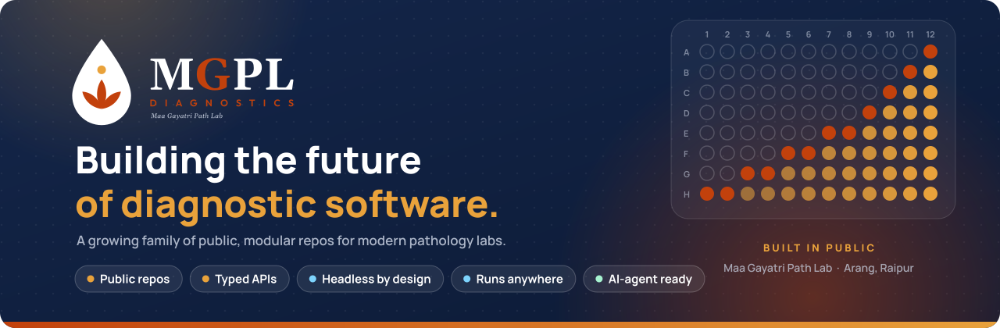
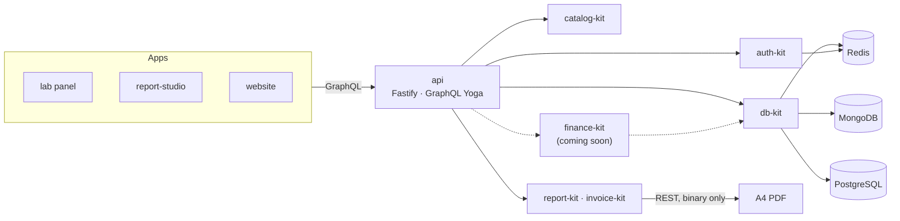

<p align="center">
  
</p>

<p align="center">
  <b>Open, modular software for <a href="https://github.com/mgpl-diagnostics">Maa Gayatri Path Lab</a></b>, a pathology laboratory in Arang, Raipur, Chhattisgarh.<br/>
  Covers patients, samples, reports, billing, books and catalog, as small typed packages that each do one job well.
</p>

<p align="center">
  
  
  
  
  
  
  
  
</p>

---

### 🧱 Backend kits

<table>
<tr>
<td width="50%" valign="top">

#### [db-kit](https://github.com/mgpl-diagnostics/db-kit) &nbsp;`data`
Patients, bookings, samples, reports, invoices and payments on **MongoDB or PostgreSQL**, behind one API.
Workflows are ACID on both. Books are double-entry, Tally-style, with trial balance, P&L, balance sheet
and GST. Includes a Redis cache toolkit.

</td>
<td width="50%" valign="top">

#### [auth-kit](https://github.com/mgpl-diagnostics/auth-kit) &nbsp;`auth`
scrypt passwords and revocable sessions, plus timing-safe, rate-limited login and single-use reset
links. Roles and permissions work per branch, for a multi-branch lab.

</td>
</tr>
<tr>
<td width="50%" valign="top">

#### [catalog-kit](https://github.com/mgpl-diagnostics/catalog-kit) &nbsp;`data`
614 tests, each with parameters, units, methods, reference ranges, sample types and prices. Fuzzy search
(~30 µs) understands lab shorthand: *lft*, *kft*, *sgpt*, *fbs*, *vit d*.

</td>
<td width="50%" valign="top">

#### [report-kit](https://github.com/mgpl-diagnostics/report-kit) · [invoice-kit](https://github.com/mgpl-diagnostics/invoice-kit) &nbsp;`render`
A4 lab reports and patient invoices as PDF, rendered in pure Node.js, with matching HTML. Letterhead,
barcode, QR and GST bills accurate to the paisa.

</td>
</tr>
<tr>
<td width="50%" valign="top">

#### finance-kit &nbsp;`coming soon`
The lab's money, end to end: double-entry books, GST, receivables and payouts, built on the same
exact-to-the-paisa, ACID foundations.

</td>
<td width="50%" valign="top">

#### …and many more &nbsp;`on the way`
Each new kit does one job well and plugs into the same GraphQL API. Watch this organisation for what
ships next.

</td>
</tr>
</table>

### 🖥️ Apps and clients

| | |
| --- | --- |
| [**client**](https://github.com/mgpl-diagnostics/client) `frontend` | Headless, typed, zero-dependency SDK. Bring your own UI |
| [**report-studio**](https://github.com/mgpl-diagnostics/report-studio) `app` | Reference Next.js app: report and invoice designer, result entry |
| **api** `coming soon` | The backend: one GraphQL endpoint on Fastify that combines every kit |
| **lab-panel** `coming soon` | Registrations, samples, results, billing and books for every branch |
| **auth client** `coming soon` | Sign-in for frontends, with adapters for TanStack Query and others |

### 🧭 How it fits together



**GraphQL first.** REST appears only where it has to: PDF downloads, assets, health checks and payment
webhooks.

### ⚡ A taste

```ts
import { createDb, issueInvoice, trialBalance } from "@mgpl-diagnostics/db-kit";
import { createAuth } from "@mgpl-diagnostics/auth-kit";

const db = await createDb({ backend: "pg", pg: { url: process.env.DATABASE_URL }, redis: process.env.REDIS_URL });
const auth = createAuth({ users: db.repos.users, roles: db.repos.roles, sessions /* Redis */ });

const { viewer, can } = await auth.context(token);
if (can("invoice:create", branchId)) {
  const { invoice } = await issueInvoice(db.repos, { orgId: viewer!.orgId, branchId, patientId, items, payments });
  // → numbered MGPL/RPR01/2026-27/000045, Sales + Receipt vouchers posted, books still balance
}
```

### ✅ How we work

- **Money is exact.** Integer paise, double-entry vouchers that must balance, and ACID transactions on
  MongoDB and PostgreSQL. Tests show two concurrent overpayments can't both succeed.
- **Both databases, one contract.** The same test suite runs on real MongoDB and real PostgreSQL.
- **Secure by default.** Tokens are stored only as hashes. Data is isolated per organisation, and
  permissions are checked per branch.
- **HTML and PDF match.** One geometry, one row model, the same page breaks; every value is checked inside the PDF.
- **No patient data in any repo.** Real signatures load at runtime from the server and are never committed.
- **Docs for people and AI.** Every repo has a README, `AGENTS.md` and `llms.txt`.
- **Reviewed, always.** Nobody pushes to `main`. Every change is a pull request from a fork, with green
  CI and a code-owner review. [How to contribute →](https://github.com/mgpl-diagnostics/.github/blob/main/.github/CONTRIBUTING.md)

<p align="center"><sub>© MGPL Diagnostics (Maa Gayatri Path Lab), Arang, Raipur. Code is published for reference; all rights reserved.</sub></p>
