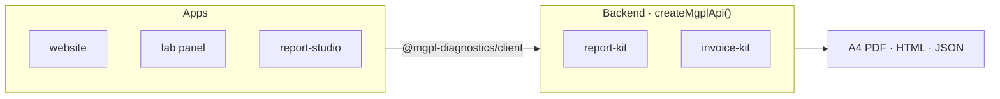

<p align="center">
  
</p>

<p align="center">
  <b>Software for <a href="https://github.com/mgpl-diagnostics/website">Maa Gayatri Path Lab</a></b>, a pathology laboratory in Arang, Raipur, Chhattisgarh.<br/>
  Lab reports, patient invoices and letterhead: generated from data, printed on A4, identical on screen and on paper.
</p>

<p align="center">
  
  
  
  
  
  
</p>

---

### 🧪 What we build

<table>
<tr>
<td width="50%" valign="top">

#### [report-kit](https://github.com/mgpl-diagnostics/report-kit) &nbsp;`backend`
Turns patient results into A4 lab reports, as PDF or HTML.
31 tests, 7 profiles, H/L flags, Navy Sidebar and classic designs, letterhead, barcode and QR.
Mounts in Next.js, Fastify, Express or Hono.

</td>
<td width="50%" valign="top">

#### [invoice-kit](https://github.com/mgpl-diagnostics/invoice-kit) &nbsp;`backend`
Patient bills accurate to the paisa: tests, packages, services, consumables, medicines, GST, discounts,
split payments, amount in words. Ships the combined reports + invoices API.

</td>
</tr>
<tr>
<td width="50%" valign="top">

#### [client](https://github.com/mgpl-diagnostics/client) &nbsp;`frontend`
Headless, typed, **zero-dependency** SDK for every MGPL backend.
Bring your own UI; optional unstyled React hooks.

</td>
<td width="50%" valign="top">

#### [report-studio](https://github.com/mgpl-diagnostics/report-studio) &nbsp;`app`
The reference Next.js app. A custom UI on the client SDK, the kits as its backend, and a result-entry form
generated from the test catalog.

</td>
</tr>
<tr>
<td width="50%" valign="top">

#### [website](https://github.com/mgpl-diagnostics/website) &nbsp;`app`
The lab's public website.

</td>
<td width="50%" valign="top">

#### lab-panel &nbsp;`coming soon`
The lab's internal panel for registrations, results and billing, built on the kits above.

</td>
</tr>
</table>

### 🧭 How it fits together



**Frontends** install only the tiny client and design their own screens.
**One backend** (Next.js route, Fastify plugin or Express) renders every report and invoice in Node.js, with no browser.

### ⚡ Try it

```ts
// backend — e.g. app/api/mgpl/[...path]/route.ts
import { createMgplApi } from "@mgpl-diagnostics/invoice-kit";
const api = createMgplApi();
export { api as GET, api as POST, api as OPTIONS };
```

```ts
// frontend
import { createMgplClient } from "@mgpl-diagnostics/client";
const pdf = await createMgplClient().reports.pdf({
  patient: { name: "Kavita Sharma", age: 32, sex: "Female" },
  tests: [{ template: "cbc", results: { hb: "10.8" } }],
});
```

### ✅ How we work

- **HTML and PDF match.** One geometry file, one row-height model, the same page breaks.
- **Tested, not hoped.** Every sample is rendered in every design and variant, and each value is
  verified *inside* the PDF text. Text fit and font glyphs are checked before a release.
- **Private by default.** No patient data in any repo; the real signature is loaded from the server, never committed.
- **Docs for people and AI.** Every repo has a README, `AGENTS.md`, `llms.txt` and `llms-full.txt`.
- **Reviewed, always.** Nobody pushes to `main`. Every change is a pull request from a fork, with green CI
  and a code-owner review. [How to contribute →](https://github.com/mgpl-diagnostics/.github/blob/main/.github/CONTRIBUTING.md)

<p align="center"><sub>© MGPL Diagnostics (Maa Gayatri Path Lab), Arang, Raipur. Code is published for reference; all rights reserved.</sub></p>
